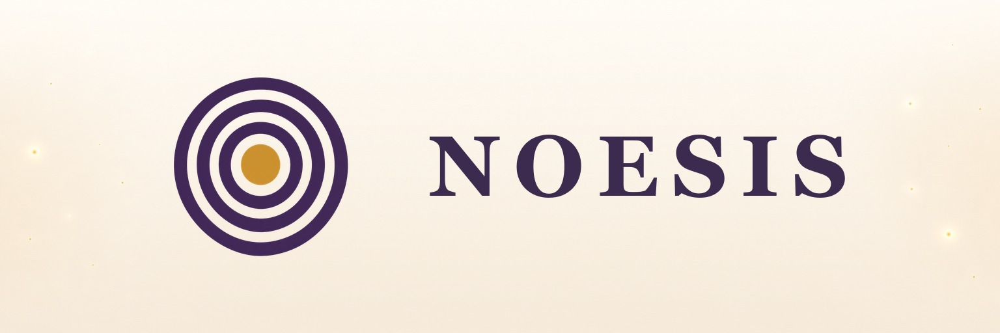
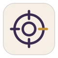

<div align="center">



# Psychology Plugin

**Think it through. Then take the next step.**

For people who use AI to sort through ideas and want to act on what they decide.
Use chosen experiences and goals in your usual AI chat, then track your next step in Today.

**[Install in your AI](#install-in-your-ai)** · [Try Today first](https://noesis.seges.ai/en/today/)

Free, noncommercial health and growth tools. Reflection, not diagnosis or treatment.

Source package **v1.4.2** keeps the selected MCP-only distribution and adds a distinct workflows application source profile while preserving the complete manual/runtime workflows. GitHub releases and host acceptance are
separate; check the [source releases](https://github.com/seges-plugin/Psychology-Plugin/releases/latest)
and linked public records for current publication and support. A source version does not update an
installed plugin or a host's tool schema.

[](../LICENSE)
[](../.mcp.json)

</div>

| What you can do | What that changes | What you keep control of |
|---|---|---|
| Reflect on memories and past chats you choose | Start from available examples instead of repeating your background | Review suggestions and correct or skip them |
| Review a goal and one next step | Connect reflection to a concrete action you choose | Keep the draft in the chat unless you separately choose storage |
| Use the Today website | Track a task, mark it complete, and choose timezone and email reminder preferences | Separate website consent and settings; no automatic MCP workspace writes |

The plugin is **Psychology Plugin**; its hosted connector is **Psychology MCP**. See the
[naming contract](../docs/naming.md), [public release records](https://noesis.seges.ai/ai/release-records.json),
and [supported-client record](https://noesis.seges.ai/ai/supported-clients.json) for their separate boundaries.
Source releases and catalog entries are not proof that every tool works in every host.

## Install in your AI

Choose [Claude.ai](#add-to-claude-ai), [Codex](#use-psychology-plugin-in-codex),
[Claude Code](#use-psychology-plugin-in-claude-code), [Kimi Code](#use-psychology-plugin-in-kimi-code),
or [ChatGPT](#use-psychology-plugin-in-chatgpt). Check [host availability](#host-availability)
before setup. Installation and OAuth connection are separate; neither grants access to all past chats.

## First session: start from what you've already told your AI

Run the [quick-start prompt](../skills/memory-distillation/references/connected-chat-distillation-prompt.md)
in the AI chat you already use. It asks the assistant to try memory or past-chat retrieval that the current
host actually exposes; if history is unavailable, it can continue with the current chat or excerpts you
choose. A session-only draft does not require an MCP connection.
Connect Psychology when you want Noesis tools or access to selected Noesis-stored context. Jump to
[Claude.ai setup](#add-to-claude-ai) or [ChatGPT connection setup (private evaluation)](#use-psychology-in-chatgpt).
The current published support record covers Claude.ai web and desktop; ChatGPT custom connectors and Codex
remain evaluation/setup paths.
Psychology shows the examples behind suggestions and asks only consequential gaps.
For ChatGPT, Claude, or Kimi, use the [v2 selected-memory summary prompt](../skills/memory-distillation/references/selected-memory-summary-prompt.md).
For Codex, use the [v3 Codex-selected summary prompt](../skills/memory-distillation/references/selected-memory-summary-prompt-v3.md): it processes only excerpts you select or paste in the current Codex task and never searches other tasks or account history. Codex is a source format here, not a claim that Codex is an accepted connected host. For detailed timestamp and selected-import cases, see the [advanced bitemporal prompt](../skills/memory-distillation/references/connected-chat-distillation-prompt-advanced.md).
The quick-start prompt asks no more than three follow-up questions, and only when an answer could change the next step.
If the connected assistant cannot access older chats or finds no relevant past chats, it says so before
continuing with the context already visible or a few conversations you select; do not upload a full account archive.

<details>
<summary>Source, timestamp and optional storage details</summary>

Only when you choose the selected-summary fallback, ChatGPT, Claude, and Kimi use v2; Codex uses v3 only for excerpts you select or paste from the current task. The v3 contract rejects a claimed Codex memory saved/updated timestamp because this workflow has no separate Codex memory-record clock.

For changing goals, Psychology separates when a statement happened, when it was saved, and when it applied. It
uses your current corrections and does not guess when an older goal ended. See the advanced prompt for detailed
timestamp handling.

After installing Psychology, using context you choose from an AI's accessible memories or past chats is the
recommended first task. Installation alone does not authorize a read. Start it by running the prompt above in
the source AI, choose the goal and source you want used, then review or correct the resulting candidates. If you
want selected eligible candidates retained in Noesis, explicitly choose that separate step after review; the
dedicated import flow checks its purpose-specific consent and records source time separately from the server's
`observed_at`. If the source host cannot expose the requested history, Psychology must say so and offer selected
excerpts or a purpose-limited summary. It never claims to read another account's history or to import a full archive.

The copyable prompt and Codex's first-use default reply in the language of the request. Codex uses only the current
task and excerpts you select or paste; it cannot search other tasks, saved memories, workspace files, or account
history. Ordinary distillation does not list or read stored Noesis records. Reading selected Noesis imports requires
an explicit request and an exact active grant.

Pasted summaries and platform-memory candidates stay session-only unless you separately choose the site's
item-by-item selected-context retention flow. Imported candidates never become ordinary profile fields and are
not saved through the generic profile tools, even when you confirm or edit them. Generic profile saves are only
for eligible direct statements from a separate current-session interaction that does not carry imported text as
evidence.

</details>

### Host availability

The published host listing currently covers Claude.ai web and desktop, dated 2026-08-30; Anthropic
does not publish a host version identifier. ChatGPT custom connectors and Codex remain private evaluation/setup
paths; Claude Code, Kimi Code, Kimi.ai, and OpenClaw are evaluation/setup paths, not accepted hosts. A
manifest, installation, visible server, or login screen does not establish host acceptance or an
authenticated connection. See [host acceptance](#host-acceptance) and the [public support record](https://noesis.seges.ai/ai/supported-clients.json).

### What the source AI can retrieve

The memory-distillation prompt runs in the AI account the person chooses as a source. It does not give the
Psychology plugin an API for enumerating that account's archive. In ChatGPT, Memory may use relevant past-chat
information when the account's plan, region, settings, and workspace allow it; it does not retain or return every
detail from every chat. See [OpenAI's Memory guide](https://help.openai.com/en/articles/8590148-memory-in-chatgpt).
Claude's past-chat search is available only where Anthropic has rolled it out and the account's settings permit it;
project chat search is limited to the selected project. See [Anthropic's personalization guide](https://support.anthropic.com/en/articles/10185728-understanding-claude-s-personalization-features).
Ask the source AI for the user-selected topic or conversation and treat its response as a partial, unverified
summary. If the feature is unavailable, use only excerpts or summaries the person deliberately supplies.
Psychology cannot force either host to search, recover, or export the full account history.

## What Psychology is

<div align="center">

</div>

Psychology combines selected conversation context, published self-assessments, and practical
reflection. It also offers plain-language interpretation and informational referral leads that users
verify independently.

### Public claims

Public product and connection claims follow the versioned [Psychology release records](https://noesis.seges.ai/ai/release-records.json)
and [supported-client record](https://noesis.seges.ai/ai/supported-clients.json). They publish status,
source, limitations, and review date; private acceptance receipts, browser traces, user content, and
OAuth artifacts are not published here.

## Self-assessment and conversational reflection

A named self-report item may receive a source-linked candidate based on context the person selected and the
assistant can actually access. Keep the exact item wording and response scale; the person can confirm, edit,
reject, or skip each candidate. Only user-endorsed responses enter formal scoring. Objective performance,
knowledge, and ability-test items are respondent-only. An AI-assisted conversational estimate is a separate,
session-only reflection, not a standardized score. Before G2 execution, independent review, and release, it must
not be scored, stored, exported, or presented as a standardized score.

This repository contains portable skills, agents, package metadata, and a pointer to the hosted MCP
endpoint. It intentionally does not contain scoring implementation, item banks, user data, OAuth
secrets, static access tokens, or private server code.

Referral results, when available, are informational leads. Users independently verify a provider's
credentials, availability, scope, jurisdiction, and suitability before relying on a referral.

## What Psychology helps with

<table>
<tr>
<td align="center" width="25%">
<br />
<b>Self-assessment</b><br />
<sub>Published, source-aware psychometric instruments</sub>
</td>
<td align="center" width="25%">
<br />
<b>Coaching &amp; growth</b><br />
<sub>Plain-language reflection on how you think, decide, and learn</sub>
</td>
<td align="center" width="25%">
<br />
<b>Counselor matching</b><br />
<sub>Informational referral leads you verify independently</sub>
</td>
<td align="center" width="25%">
<br />
<b>Crisis safety net</b><br />
<sub>Clear signposting to local emergency and crisis services</sub>
</td>
</tr>
</table>

<div align="center">

</div>

## Use Psychology Plugin in Codex

Installing `Psychology Plugin` in Codex loads its portable workflow and safety skills. It does **not** by itself
complete the separate OAuth connection to the hosted Noesis MCP. A first-use response must make that distinction
visible. If a person asks to distil memories or past chats, it can act on context available in the current task
without MCP; the result stays session-only and it must say when older history is unavailable. Offer secure Codex
connection when they ask for Noesis tools or account-backed data. It must not send a Codex user to ChatGPT
Developer mode or a Claude setup page. The package's `skills/psychology/SKILL.md` is the mandatory `@Psychology`
front door, so this distinction is not left to a later assessment or coaching skill.

If Codex already lists a Noesis MCP server, select its normal **Sign in** or **Reconnect** action instead of
creating another entry. If it was configured with a legacy protected-resource value, reconnect or replace that
one entry with the canonical root resource below; do not keep both resource variants. Otherwise, after deciding
to make this local configuration change, run:

```powershell
codex mcp add psychology_mcp --url https://noesis.seges.ai/mcp --oauth-resource https://noesis.seges.ai/mcp
codex mcp login psychology_mcp --oauth-client-registration dcr
```

The login command opens the official Noesis browser sign-in and consent flow. Do not paste a password, client ID,
redirect URI, OAuth code, token, authorization header, or callback URL into Codex. Start a new task after sign-in,
confirm a callable `psychology_...` tool is present, and make `psychology_get_consent_status` the first harmless
read-only check. A connected account does not automatically read profile, journal, result, or imported-memory data.

## Add to Claude.ai

<a id="add-to-claude-ai"></a>

Use the plugin first so Claude can load Psychology's portable skills and safety instructions:

1. Open [Claude.ai Customize → Plugins](https://claude.ai/new#settings/customize-plugins).
2. Choose **Add → Add marketplace → Add from a repository**.
3. Paste `https://github.com/seges-plugin/Psychology-Plugin` into the repository URL field and
   choose **Sync**.
4. Open the synced marketplace and review the Psychology plugin before choosing to install it.

Claude.ai does not currently document a public plugin-marketplace deep link that can prefill the
repository URL. The link above opens the Plugins page only; it does not sync or install anything.

After installing the plugin, add its hosted connector if Claude has not already asked you to do so.
You can open the
[prefilled custom-connector form](https://claude.ai/new?modal=add-custom-connector&connectorName=Psychology%20MCP&connectorUrl=https%3A%2F%2Fnoesis.seges.ai%2Fmcp#settings/customize-connectors)
or enter `https://noesis.seges.ai/mcp` yourself. Review the displayed name and URL before continuing.
This is a two-step setup: install the plugin, then connect the hosted MCP. When Claude asks which OAuth client to use, choose the **No client ID** option that registers a client automatically.
Noesis intentionally supports Dynamic Client Registration (DCR) for this flow and does not support
Client ID Metadata Documents (CIMD).

These links and steps are setup conveniences, not evidence of sync, installation, connection, OAuth
completion, or a particular account's connection. The public support record lists Claude.ai web and
desktop with a 2026-08-30 acceptance date; it does not cover Claude Code or Claude mobile.

## Use Psychology Plugin in Claude Code

Claude Code is a separate product from Claude.ai. In a Claude Code session, add this [Claude Code
marketplace](https://code.claude.com/docs/en/plugins/install) and install its `psychology-plugin` plugin:

```text
/plugin marketplace add seges-plugin/Psychology-Plugin
/plugin install psychology-plugin@psychology-plugin
```

Review the plugin and choose an install scope. The Claude manifest explicitly declares
Psychology MCP using Claude's `http` transport; the root `.mcp.json` retains Codex's
URL-only format. In Claude Code, open `/mcp`, select the plugin-provided server, and
use its normal authentication action. Its scoped name is
`plugin:psychology-plugin:psychology_mcp`; use the exact name shown by the host rather
than a bare CLI alias. If you install it from the shell or add it during a session,
start a new session or run `/reload-plugins` to apply it.

Claude Code and Claude.ai manage connector authorization separately. Installing this plugin in
Claude Code does not connect a Claude.ai account, and adding the Claude.ai connector does not install
this repository's plugin. The public acceptance record covers Claude.ai web and desktop only; Claude
Code remains an unverified evaluation target until it completes its own acceptance sequence.

## Use Psychology Plugin in Kimi Code

Install this repository as a custom [Kimi Code plugin](https://github.com/MoonshotAI/kimi-code/blob/main/docs/en/customization/plugins.md):

```text
/plugins install https://github.com/seges-plugin/Psychology-Plugin
```

Enable it in `/plugins`, then run `/reload` or start a new session. The `kimi.plugin.json` manifest
declares both `./skills/` and the hosted MCP server. Complete browser authorization with
`/mcp-config login psychology_mcp`; then confirm the server is connected in `/mcp` and that its tools
are available. The Kimi.ai consumer app and Kimi Code CLI have different plugin and MCP
configuration surfaces; these steps apply to Kimi Code CLI only.

Plugin installation, reload, or a visible server entry does not prove OAuth completion or host
acceptance. Kimi Code is not listed in the current public support record. Use only the authenticated
`psychology_…` tool names returned by the connected server.

## Use Psychology Plugin in ChatGPT

<a id="use-psychology-in-chatgpt"></a>

This repository includes the portable Agent Plugins package files at its root: `plugin.json` describes the
plugin and `mcp.json` declares its hosted MCP server and OAuth Dynamic Client Registration. Use an
OpenAI-supported plugin/package source in the ChatGPT Plugins Directory to install or evaluate the package;
local marketplace options and UI availability depend on the ChatGPT app, account, and workspace. See
[OpenAI's plugin packaging guide](https://developers.openai.com/plugins/build/plugins) for the supported
package and marketplace flows.

A GitHub repository URL by itself is not an MCP server URL. If you are adding a custom MCP server directly,
use `https://noesis.seges.ai/mcp` in ChatGPT's MCP connection form, not the GitHub URL. ChatGPT then discovers
the MCP tools from the hosted server and completes OAuth on Noesis pages. The repository's plugin manifests
are not read by that direct-connector flow.

If the account or workspace requires it for custom MCP connections, review [ChatGPT Security settings:
Developer mode](https://chatgpt.com/#settings/Security?section=developer-mode) and open [ChatGPT Plugin
Management](https://chatgpt.com/#settings/Plugins). Read any host warning before changing this persistent
setting; Psychology cannot enable it for you.

For either path, verify authenticated `tools/list`, one harmless read-only action, consent/source-choice
behavior, revocation, and reconnect before treating the connection as usable. A saved draft, successful scan,
or visible connector is not a public listing and does not establish ChatGPT host acceptance. UI labels and
availability can vary by account or workspace.

## Connect a host

The connector endpoint is:

    https://noesis.seges.ai/mcp

The canonical protected MCP resource is `https://noesis.seges.ai/mcp`, and the public catalog is
`https://noesis.seges.ai/info`. Every actual tool or prompt call must use the exact visible
`psychology_…` name supplied by authenticated `tools/list`; names in a returned score record or internal
schema are data identifiers, not callable aliases.

Use it only in a host that provides a remote Streamable HTTP MCP connector and can complete its own
browser OAuth authorization-code flow with S256 PKCE.

1. Add the endpoint in the host's remote MCP connector settings.
2. Let the host discover the OAuth metadata and start its browser authorization flow.
3. Complete sign-in and review the scope at noesis.seges.ai.
4. Return to the host and confirm that it can use the authenticated connector.

Do not paste a static bearer token, password, personal access token, or authorization header into a
configuration file. Psychology public MCP access is OAuth-only. If a host cannot complete the browser flow,
there is no supported credential workaround.

**OpenClaw (an unverified evaluation target, not a supported host):** OpenClaw's [native plugin
manifest](https://docs.openclaw.ai/plugins/manifest) and [MCP OAuth flow](https://docs.openclaw.ai/cli/mcp/transports) can
declare static MCP servers. Install this repository as a plugin from GitHub, review
and confirm the source when OpenClaw prompts, then enable `psychology-plugin`:

```sh
openclaw plugins install git:github.com/seges-plugin/Psychology-Plugin
openclaw plugins enable psychology-plugin
```

Inspect it with `openclaw plugins inspect psychology-plugin`. The manifest contributes the skills and a
remote Streamable HTTP MCP server using OpenClaw's native OAuth configuration; it does not require a
second manual server entry in `openclaw.json`.

Complete browser authorization with `openclaw mcp login psychology_mcp`. Check the saved connection
with `openclaw mcp status --verbose` and run `openclaw mcp doctor psychology_mcp --probe` to verify
reachability and tool discovery. Plugin install, enablement, or saved credentials alone do not
prove that authenticated tools work or that this host version has passed acceptance.

Before an installation guide, marketplace listing, or support claim names a host, that host and exact
version must have a passed acceptance record. Until then, describe it only as an unverified evaluation
target.

## Public MCP-only distribution

The selected `portal-mcp` package uses machine ID `psychology-plugin` and connects Psychology MCP for explicitly requested reflection guides, psychometric instruments, and authorized selected Noesis records. It does not include bundled skills, agents, hooks, or onboarding automation. It does not promise automatic invocation or automatic memory writes.

A separate `portal-workflows` application source profile uses machine ID `psychology-plugin-workflows`. It includes all 16 skills, supporting references, the memory working schema and three skill-local `agents/openai.yaml` UI/policy files. Root agent bundles, lifecycle hooks, app bindings and alternate host manifests are excluded. Both profiles display **Psychology Plugin** and use the same **Psychology MCP** server, key `psychology_mcp`, endpoint and OAuth configuration. See the [workflows profile](../packaging/portal-workflows/README.md) and all four [package variants](../docs/package-variants.md).

The workflows profile is a separate application proposal; do not upload it over the existing MCP-only draft. Its source definition and local checks do not establish Portal import, invocation, eligibility or approval. Both applications retain the actual psychometric, health-related, professional-listing and account-write review requirements. The legacy `portal` package and full manual `runtime` package remain separate distributions; only the runtime includes optional trusted hooks.

## Personal workspace and natural-language requests

The local workflow below belongs to the separate full source/manual distribution with 16 skills;
it is not included in the public `portal-mcp` package. The separate `portal-workflows`
source profile bundles these skills for its own application review; host selection remains conditional.

Psychology now has an ongoing [memory-update loop](../skills/memory-updates/SKILL.md): meaningful personal
decisions, corrections, life changes and growth needs can activate it without typing "remember" or another
@mention. It distils source-linked changes, uses the smallest useful available MCP and offers the proper
structured retention path. It revisits new signals after bootstrap, reuses current source choices and
continues the task while candidates await review. A correction is immediately useful in the conversation;
the assistant reports whether it was actually saved, awaits review or is blocked.

Manual runtime installs also include an optional local SessionStart/UserPromptSubmit routing hook. It only
adds bounded workflow hints, never reads private transcripts or writes memory. Node.js, compatible host
support and exact-definition hook trust are required. The selected public `portal-mcp` package has
zero skills and no hooks, agents or onboarding automation; it does not guarantee implicit activation.
The separate `portal-workflows` source profile and legacy full `portal` variant exclude hooks;
**the runtime ZIP is not the public MCP-only ZIP**. See
[activation, storage destinations and host acceptance](../docs/activation-and-memory.md).

The front-door skill applies to relevant personal-growth, non-clinical reflection, life-goal, journaling,
and selected-memory requests even when you do not type `@Psychology`. Actual skill selection depends on
the host; installation does not guarantee a call in every chat or grant access to past conversations.

The website workspace and the Psychology MCP have different capabilities. This distribution does not
claim a live workspace MCP bridge. Check the current authenticated capability and exact schema before a
task/reminder action; absent, old or refused capability must fall back rather than invent a tool. For an explicit workspace
save request, the assistant can prepare a session-only draft and direct you to
[Today](https://noesis.seges.ai/en/today/) ([繁體中文](https://noesis.seges.ai/zh-tw/today/)), where you sign in,
choose the applicable scope, review the exact information, and confirm its save. Profile, journal,
assessment, and selected-import consent do not authorize workspace access. A draft or page link is not
proof that a record was saved. The plugin does not automatically ingest all past chats or build a CRM
or financial graph after installation.

## Consent and storage

Profile and trajectory persistence require the owner-review protocol introduced in v1.3.2.
Use it only when authenticated discovery exposes the preparation tool and matching receipt-only save schema.
A person must explicitly permit temporary draft storage and review the exact draft in their signed-in
Noesis account before the matching save. Missing, pending, rejected, expired or stale reviews stop writes.
Preparation and save must use the same exact integration namespace, with only the matching server-issued
`review_id` sent to the receipt-only save. An old profile/context-content save schema is not a fallback.
An assistant never approves the draft or accepts a ToolPermission prompt for the person.
Package validation and a GitHub release do not establish a host schema refresh or a completed review flow.

Psychology does not load stored results, profiles, or journal content by default. In every relevant session,
the assistant must:

1. Call `psychology_get_consent_status` before account-data reads.
2. Show the currently authorized source choices.
3. Ask the person to make an explicit per-session choice.
4. Read only the minimum selected and authorized source.

`psychology_journal_view_memory` is permitted only after the applicable journal consent and the person's explicit
per-session source choice. No MCP tool grants consent. Consent is completed in the signed-in website
experience; journal grant creation and scope changes are managed there, not through MCP. A refused or unavailable
source must not be retried or bypassed.

The full source/manual distribution includes the user-need-to-skill-to-MCP flow: start with the
[session bootstrap](../skills/00-session-bootstrap/SKILL.md), use the
[context-session contract](../skills/context-session/SKILL.md) for source-bounded context, and follow the
[assessment guide](../skills/assessment-guide/SKILL.md) or [coaching guide](../skills/coaching/SKILL.md) for
the requested workflow. These tracked files define session-only context distillation, minimum source
reads, adaptive assessment gaps, and exact visible public tool names without relying on an unpublished
maintainer document. These workflow files are absent from the public MCP-only ZIP.

<div align="center">

</div>

## Safe use

- Treat results as structured reflection, not a clinical conclusion.
- Explain what an instrument does and does not establish before interpreting it.
- Do not infer, retain, or reuse personal context without the required consent and current-session choice.
- For urgent safety concerns, contact local emergency or crisis services. Psychology does not replace them.

## Host acceptance

Record an immutable acceptance result for the exact host and plugin commit. Capture the precise host
version/build/channel when the vendor exposes one. If it does not, record the acceptance date and the
version-identification limitation, as the public Claude record does. The minimum acceptance sequence is:

1. OAuth discovery and browser authorization-code flow with S256 PKCE.
2. Clear sign-in and consent experience.
3. Authenticated tools/list.
4. One harmless read-only MCP call.
5. A consent check before any stored-data read.
6. An explicit per-session source choice before any stored-data read.
7. Refresh, revocation, reconnect, and replay-rejection checks where the host exposes those paths.
8. Desktop and mobile behavior when both are offered by the host.

The acceptance record is the evidence for a support claim. A successful build, public endpoint, tool
catalog, or login screen is not a substitute.

## Repository layout

- `plugin.json` and `mcp.json` at the repository root are the portable Agent Plugins package entry point and ChatGPT-compatible MCP declaration.
- `.mcp.json` and `.codex-plugin/plugin.json` provide the Claude Code remote MCP config and Codex-compatible MCP configuration.
- `.claude-plugin` contains Claude Code marketplace metadata; Claude.ai connector setup is separate.
- `kimi.plugin.json` declares the Kimi Code CLI skills and MCP server; `openclaw.plugin.json` declares OpenClaw-native skills and OAuth MCP wiring.
- skills and agents contain portable instruction contracts.
- `hooks/hooks.json` and `hooks/intent-router.cjs` provide the trusted local runtime routing hooks; the public Portal ZIP excludes the whole hooks directory.
- `schemas/memory-update.schema.json` defines the local working envelope; it is not an MCP payload or database migration.

## Support

Found a problem, have a question, or want to report a security or privacy concern? Contact
**problems@noesis.seges.ai**. We do not currently offer a guaranteed response time. For questions
about the Terms of Service or data processing specifically, use the same address. Full reporting
guidance, including what not to send by email and what to do in an emergency, is published at
https://noesis.seges.ai/support/.
## License

[MIT](../LICENSE)

## Historical source and verification notes

These dated records describe the package and acceptance boundary at their original checkpoint.
Old tool counts, account-grant observations and release-candidate states are historical, not current
account state or a new host acceptance result. Current setup follows the sections above and the linked public records.

### Source package v1.3.0 review candidate (2026-10-20)

The package display name is **Psychology Plugin**, and the hosted connector display
name is **Psychology MCP**. Package IDs are `psychology-plugin`; all bundled MCP
configuration keys are `psychology_mcp`. The deployed tool namespace remains
`psychology_`. This changes installation identifiers; follow the
[migration and naming contract](../docs/naming.md) before reconnecting.

This source revision aligns the OpenAI/Codex listings, provides a Claude-specific
HTTP MCP definition, integrates session-only goal
review, and applies the canonical interpretation safeguards to the bundled agents.
Ignored maintainer files and private runtime code are not distribution inputs.
The linked hosted policies and each actual host connection require separate live
verification. No submission ZIP will be built from this revision before owner review.

### Previous source package v1.2.23 candidate

First-run guidance now starts with memories and past chats that the connected host can actually expose or that the user chooses to provide. The assistant drafts a session-only distillation first. Retaining selected material in Noesis is a separate step that requires item review, current purpose-specific consent, and final confirmation. Installing the plugin does not grant access to a full ChatGPT, Claude, or other account archive. This source update does not prove that a host can enumerate historical chats or that production accepted a bitemporal write and exact readback; the live OAuth connection currently has no active selected-context grants and the production MCP catalog has no dedicated selected-import write tool.

## Source package v1.2.21 submission candidate (2026-10-16)

This candidate aligns the OpenAI portable manifest and Codex overlay with the current package contract, keeps one canonical root skills tree and portable MCP configuration, and includes light/dark listing assets. Source commit `48b604cb5aad4c341af1a120f3e7bcd549b17ac7` is on `main`; GitHub CI run `38834417295` passed. `npm test` verifies 62 public files and 14 root skills. The OpenAI Linux validator and directory-listing pack builder pass locally, but the validator still asks the publisher to confirm there are no internal-only capabilities. The OpenAI developer portal has not imported or scanned the ZIP, verified the publisher/domain, run reviewer cases, or approved/published this listing. This candidate does not prove host access to historical chat archives.

## Local contract re-verification (2026-10-16)

`npm test` passes the portable contract and verifies the current live catalog: 62 public files, 14 root skills, 43 negative selected-summary fixtures, and 34 prefixed tools plus 18 prompts. This checks the source package and the catalog only; it does not establish that every ChatGPT, Claude, or other host has refreshed its MCP schema or can access a user's full chat archive.

## Source package v1.2.22 candidate (2026-10-16)

The distillation workflow now uses `psychology_prepare_profile_candidate_preview` only when a person explicitly asks to prepare qualitative profile/context candidates and the connected host reports that tool as callable. The preview requires verbatim user-authored evidence, leaves event time unknown unless supplied, keeps candidates pending review, and sets persistence and owner confirmation to false. Routine distillation remains session-only and does not invoke profile tools. This preserves compatibility with production catalogs where the staging-only preview tool is absent. The source contract checks these conditions; they do not prove a host has refreshed its catalog or that the tool is available in production.

## Source package v1.2.20 (2026-10-16)

GitHub source release `v1.2.20` adds memory-first retrieval instructions for host-accessible ChatGPT and Claude memories/past chats, limits Codex distillation to the current task and user-selected or pasted excerpts, and tightens the corresponding prompt/schema contract checks. The live runtime catalog was checked at release time and retains its existing 34 tools and 18 prompts. This source package does not prove that any host can retrieve historical sessions, that a live model follows the prompt, or that the plugin is listed in an official marketplace.

## Explicit selected-context distillation (2026-10-13)

The v1.2.13 source prompt keeps ordinary distillation limited to material available in the current assistant conversation. Only when the user directly asks to use selected Noesis imports does it check current consent, list metadata for active grants tied to that exact OAuth connection, show the scope and ask the user to choose one, and then read only with those returned purpose, categories, date bounds, and time basis. Missing, revoked, expired, or mismatched grants stop the import flow. This does not provide full-account archive access. The prompt calls selected material a purpose-limited summary, not an account export, and caps fallback follow-up questions at three consequential gaps. The production catalog exposes the matching `psychology_list_my_selected_context_grants` tool; `npm test` passes against the live 34-tool catalog. The GitHub release is source distribution and does not claim official ChatGPT or Claude marketplace acceptance.

## Selected-context session timing alignment (2026-10-16)

The memory-distillation skill and its `.codex-plugin` mirror now allow the bounded selected-context read in any session only after the user explicitly asks to use retained candidates, the current consent and exact grant pass backend checks, and the user selects the matching scope. Session start never loads retained candidates automatically. This aligns the plugin wording with the service guide. Offline contract verification and GitHub CI passed; this source-level result is not live host acceptance or a proof of archive access. The root `.gitignore` patterns for `scripts/` and `fixtures/` are anchored so they cannot hide nested package helpers.

## Candidate evidence citations (source release v1.2.14)

The first-use connected-chat prompt now asks for a compact source note beside each candidate: source platform and
type, plus a visible conversation title, stable reference, or link when available. It asks the assistant to keep
event/statement time, memory saved/updated time, summary-generation time, and claim applicability separate for
changing claims, to mark unavailable details unknown, and to include Noesis receipt time only for a reviewed
selection that actually has one. This makes the draft easier to inspect without implying a source identifier or
timestamp the host cannot expose. The same wording is included in the ChatGPT and Codex package prompts. The
manifest version 1.2.14 is published as a GitHub source release. This is not a host-acceptance claim.

## Distillation onboarding and schema clarification (2026-10-14)

The first-use connected-chat prompt is now a shorter quick-start, with the detailed bitemporal/import flow linked as an
advanced prompt. README setup links take readers directly to Claude.ai and ChatGPT instructions; ChatGPT remains a
private evaluation path, not an accepted host. ChatGPT, Claude, and Kimi generated summaries use v2; v3 remains
Codex-only for excerpts selected or pasted from the current task. Native platform memory formats remain session-only
and are not converted into Codex v3. The verifier keeps the v2 prompt's canonical digest pinned and checks this
source-to-schema mapping.

## Bounded selected-memory continuation (source release v1.2.16)

The ChatGPT/Claude/Kimi v2 selected-memory summary is capped at 32 parts (3,200 items) per chain, matching the service's import contract. If more source material remains at that limit, the prompt preserves the incomplete status and asks the user to narrow their selection; the verifier rejects a chain beyond the cap. This limits one selected-summary flow and does not imply complete access to any platform archive.

## Current and historical memory clocks (source release v1.2.15)

The quick-start now names all five relevant clocks for changing claims: source event/statement time, platform memory
saved/updated time, summary-generation time, the claim's applicability period, and Noesis receipt time only when an
actual reviewed selection has one. It also says a current correction settles the current conversation without dating
when the older claim ended. The contract verifier checks these rules and the Codex mirror. This is prompt guidance;
it does not establish that a host can access older chats or expose every timestamp.

## Consent-safe tool guidance (source release v1.2.18)

Assessment guidance now references only versioned result-save tools that are present in the authenticated
tool catalog, and only for user-requested eligible self-reports. MCP guidance no longer suggests creating
or expanding journal access grants; those choices stay in the signed-in Noesis website. The contract
verifier guards against the retired actionable tool names returning.

## Canonical OAuth resource contract (source release v1.2.19)

The canonical MCP route is `https://noesis.seges.ai/mcp` for both client configuration and the protected resource. The offline verifier compares the portable, shared, and Codex connector manifest URLs and checks this public routing statement. This documentation correction does not change OAuth server behavior or claim host acceptance.

## Consequential-only follow-up questions (source release v1.2.17)

The quick-start now asks no more than three questions, and only when each answer could change the next step. The prompt verifier protects this rule in the canonical and Codex-mirrored prompt. This is a source release; host availability and historical-chat access remain limited to each assistant's actual context.


## Distillation workflow audit refresh (2026-10-15)

The current quick-start actively asks ChatGPT, Claude, or Codex to search host-accessible memory/past chats before drafting, call the Noesis guide once, then label direct user-authored quotes separately from summary paraphrases, preserve event/save/generation/applicability/receipt clocks, and ask only consequential gaps. It explicitly says host access is not full-account access and falls back to selected/current-chat context when unavailable. Service regression tests passed, but this is prompt-contract evidence only: live host retrieval, source-message provenance, quote authorship, and model adherence have not been established. Do not describe distillation as complete across all account/host configurations until tested in those hosts.


## Plugin prompt contract verification (2026-10-15)


pm test passed locally: 94 public files and 30 mirrored skill files verified; the suite includes old-goal/current-correction temporal fixtures and the selected-memory summary negative fixtures. This validates the prompt/manifest contract only. It does not demonstrate that a connected ChatGPT, Claude, or Codex account can retrieve past sessions or that a live model follows the prompt.
